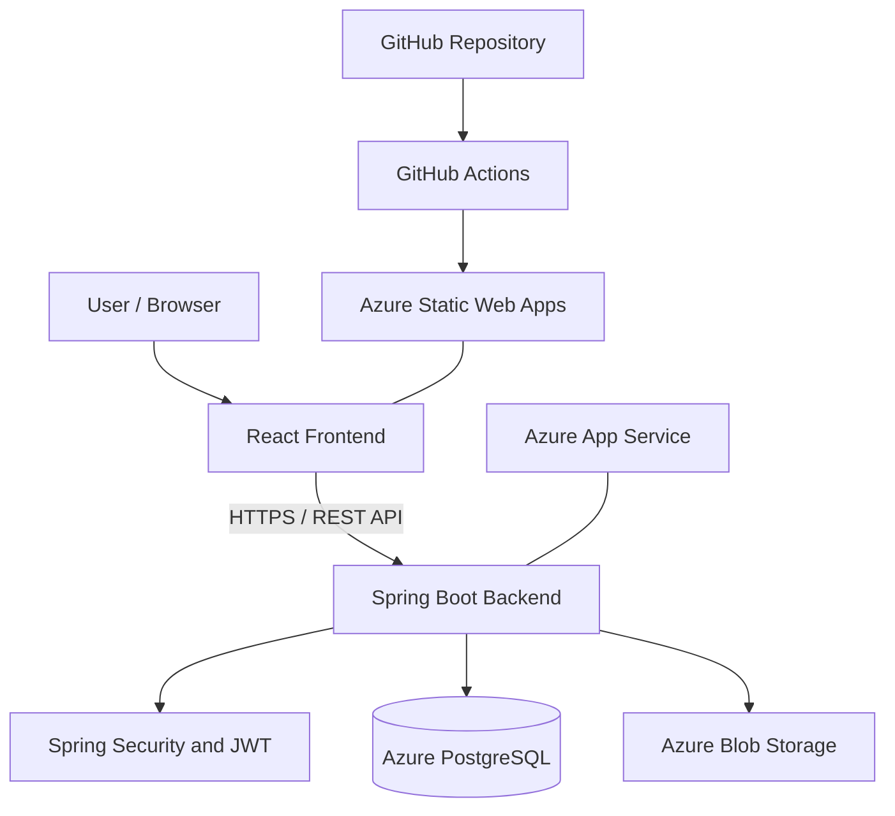

# TripWise Architecture

## Component Responsibilities

| Component | Responsibility |
|---|---|
| React frontend | User interface and API requests |
| Spring Boot backend | REST API and application logic |
| Spring Security and JWT | Authentication and authorization |
| PostgreSQL | Relational data persistence |
| Flyway | Database migrations |
| Azure Blob Storage | Document storage |
| Azure Static Web Apps | Frontend hosting |
| Azure App Service | Backend hosting |
| GitHub Actions | Configured workflows and deployment |

## Request Flow
1. The user opens the frontend over HTTPS.
2. The frontend communicates with the Spring Boot REST API.
3. The backend authenticates protected requests and validates operations.
4. PostgreSQL stores relational data.
5. Azure Blob Storage handles document operations.
6. GitHub Actions runs the workflows configured in the repository.
